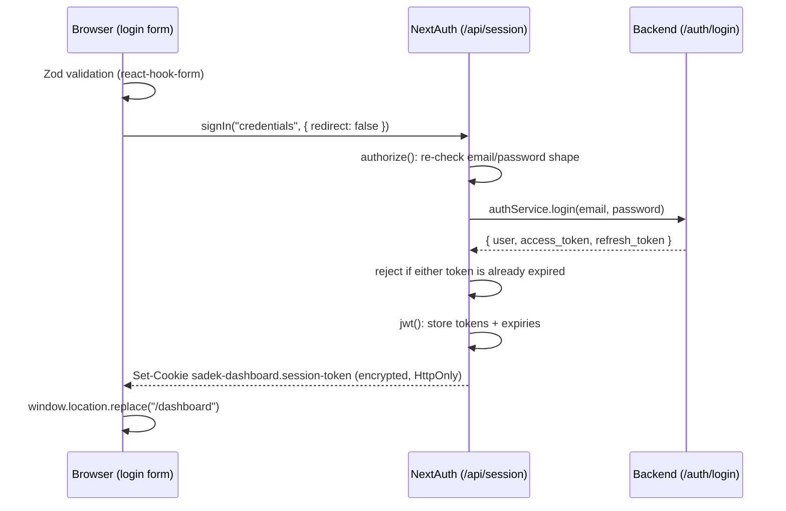
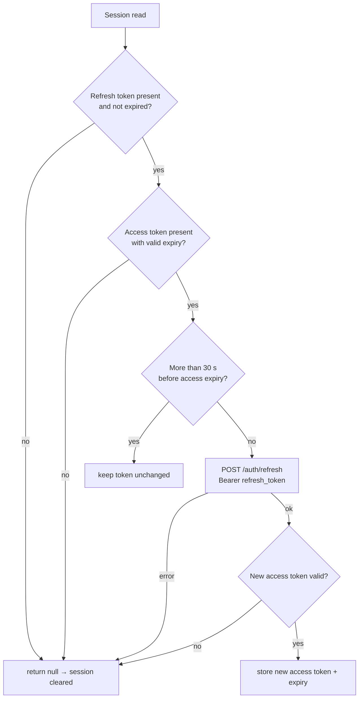
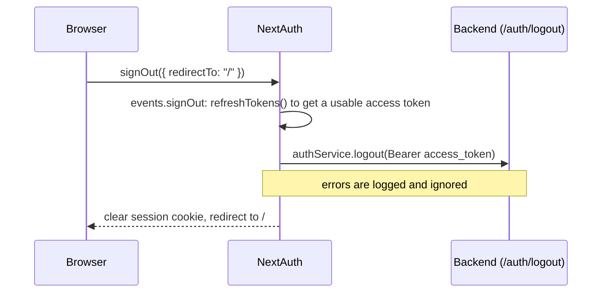

# NextAuth implementation strategy

This document explains how authentication works in the dashboard
(`apps/dashboard`). The dashboard uses NextAuth (Auth.js v5, beta) as a
**session layer in front of an external backend**. The backend owns users,
passwords, and JWT signing. NextAuth only stores the backend's tokens in an
encrypted cookie, refreshes them, and controls access to routes.

## Goals

- **No tokens in JavaScript-readable storage.** Backend tokens live in an
  encrypted, HttpOnly NextAuth cookie, never in `localStorage`.
- **The refresh token never reaches the browser.** The client session exposes
  the access token and expiry times, but not the refresh token.
- **The backend is the source of truth.** The dashboard never verifies passwords
  or signs tokens. It only reads the `exp` claim to schedule refreshes.
- **Shared and reusable.** The NextAuth configuration lives in a shared package
  so another Next.js app in the monorepo can reuse it with its own cookie
  prefix.
- **Route protection in one place.** Redirect rules live only in `proxy.ts`.

## Where things live

| Layer | File | Responsibility |
| --- | --- | --- |
| Contracts | `packages/types/src/auth.ts` | Request/response types for the backend auth API (`LoginResponse`, `RefreshResponse`, …). |
| HTTP calls | `packages/services/src/auth.ts` | `authService`: `login`, `refresh`, `logout`, `changePassword` against `/auth/*` using the shared Axios client. |
| Token logic | `packages/libs/src/auth-tokens.ts` | `AuthService` interface, `tokenExpiresAt` (reads the JWT `exp`), `refreshTokens` (refresh-or-discard logic). |
| NextAuth factory | `packages/libs/src/auth.ts` | `createAuth(backendUrl, authService, cookiePrefix)`: Credentials provider, JWT/session callbacks, cookie names, logout event, type augmentation. |
| App instance | `apps/dashboard/libs/auth.ts` | Calls `createAuth(..., authService, "sadek-dashboard")` and exports `handlers` and `auth`. |
| Route handler | `apps/dashboard/app/api/session/[...nextauth]/route.ts` | Mounts NextAuth's `GET`/`POST` handlers at `/api/session/*`. |
| Route guard | `apps/dashboard/proxy.ts` | Redirects on the server based on whether the session has an access token. |
| Client provider | `packages/provider/src/session-provider.tsx` | Wraps `next-auth/react`'s `SessionProvider` with the `/api/session` base path and polling settings. |
| Client guard | `apps/dashboard/hooks/use-required-session.ts` | Leaves the dashboard when the session ends while the user is on the page. |
| Login UI | `apps/dashboard/components/login/hooks/use-login-form.ts` | Validates with Zod, then calls `signIn("credentials")`. |

### Why `libs` receives `authService` as an argument

`@repo/services` already depends on `@repo/libs` (for the Axios client). If
`@repo/libs/auth` imported `@repo/services`, the two packages would depend on
each other. Instead, `libs` defines a small `AuthService` interface, and the app
passes the real `authService` into `createAuth`. This keeps the package graph
acyclic and makes the token logic easy to test with a fake service (see
`packages/libs/tests/auth-tokens.test.ts`).

### Why NextAuth is mounted at `/api/session`

`/api/auth/*` is already used by `next.config.js` to proxy browser requests to
the backend's `/auth/*` endpoints. NextAuth's default base path is also
`/api/auth`, so it was moved to `/api/session` to avoid the collision. The same
`basePath` is set in `createAuth` and in the client `SessionProvider`.

## Session strategy: JWT in an encrypted cookie

`session: { strategy: "jwt" }` means there is no session database. NextAuth
encrypts its own JWT with `AUTH_SECRET` and stores it in the
`sadek-dashboard.session-token` cookie. That NextAuth JWT contains:

| Field | Source |
| --- | --- |
| `sub` | Backend user id (`user.sub`) |
| `email` | Backend user email |
| `accessToken` | Backend access token |
| `refreshToken` | Backend refresh token (server only) |
| `accessTokenExpires` | `exp` of the access token, in ms |
| `refreshTokenExpires` | `exp` of the refresh token, in ms |

The `session` callback copies only `user.id`, `accessToken`,
`accessTokenExpires`, and `refreshTokenExpires` into the session object returned
by `/api/session/session` and `useSession()`. The refresh token is
intentionally left out.

### Cookie prefix

Every NextAuth cookie (session token, CSRF token, callback URL, PKCE, state,
nonce, WebAuthn challenge) is named `<cookiePrefix>.<name>`. The dashboard uses
`"sadek-dashboard"`, so a second app on the same domain (for example the
portfolio site) can use a different prefix without overwriting the dashboard's
session. Only the names are changed. HttpOnly, SameSite, `Secure`, and path
settings keep NextAuth's defaults. Changing the prefix signs everyone out.

## Flows

### 1. Sign in

- The form validates on the client, and `authorize()` validates the input again
  on the server, because the client check can be bypassed.
- Any backend error, or a token that is already expired, makes `authorize()`
  return `null`. NextAuth treats that as a failed sign-in, and the form shows a
  generic "Sign in failed" message.
- After success the hook does a **full navigation** instead of
  `router.push`, so the request passes through `proxy.ts` with the new cookie.

### 2. Every session read: refresh or discard

The `jwt` callback runs whenever NextAuth reads the session: client polling of
`/api/session/session`, `auth()` in `proxy.ts`, and the logout event. It always
ends by calling `refreshTokens(token, ...)`, which decides:

Design decisions:

- **Refresh 30 seconds early** (`ACCESS_TOKEN_REFRESH_MARGIN_MS`), so a request
  that starts just before expiry does not carry a token that expires in
  transit.
- **Keep the original refresh token.** The backend's refresh endpoint returns
  only `access_token`, so the refresh token from login is reused until it
  expires. When it expires, the user has to sign in again.
- **Fail closed.** Any missing field, bad expiry, or backend error returns
  `null`, and NextAuth then drops the whole session cookie. There is no retry
  loop and no half-valid session.
- **Expiry is read, not verified.** `tokenExpiresAt` only base64-decodes the JWT
  payload to read `exp`. Signature verification stays with the backend, which
  rejects tampered tokens on every request.

### 3. Route protection

`proxy.ts` wraps the request in NextAuth's `auth()` and runs only on `/` and
`/dashboard/:path*`:

| Request | Has access token | Result |
| --- | --- | --- |
| `/dashboard/**` | no | Redirect to `/` |
| `/` (login) | yes | Redirect to `/dashboard` |
| anything else | — | Continue |

This is the only place redirects are decided. Pages do not repeat the check.

On the client, `useRequiredSession()` calls `useSession({ required: true })`.
When polling finds that the session ended (for example a failed refresh), it
does a full navigation to `/`, so the proxy sees the cleared cookie.

### 4. Client polling

`SessionProvider` (from `@repo/provider/session-provider`) refetches the session:

- on an interval (`refetchInterval`, currently 10 minutes),
- when the tab regains focus,
- but not while the browser is offline.

Each refetch runs the `jwt` callback, so polling is what keeps the access token
fresh during long visits. The interval should stay shorter than the access
token's lifetime minus the 30-second margin. Otherwise the token can expire
between polls, and the next request made with it would fail until the next
session read refreshes it.

### 5. Sign out

The backend logout is best effort. The local cookie is always cleared, even
if the backend is down, so the user is never stuck signed in.

## Configuration

Set these in `apps/dashboard/.env.local` (see `.env.example`). They are also
declared in the dashboard's Turbo task `env` so changes invalidate the cache.

| Variable | Used by | Purpose |
| --- | --- | --- |
| `AUTH_SECRET` | NextAuth | Encrypts the session cookie. Use a long random value, for example `npx auth secret`. |
| `AUTH_URL` | NextAuth | Public dashboard URL including `/api/session`, needed in production. |
| `AUTH_TRUST_HOST` | NextAuth | Set to `true` only behind a trusted reverse proxy. |
| `NEXT_PUBLIC_BACKEND_URL` | `libs/auth.ts`, Axios client | Backend base URL used by server-side auth calls and browser requests. |
| `BACKEND_URL` | `next.config.js` | Target of the `/api/auth/*` rewrite (default `http://localhost:4000`). |

## Known gaps

These are places where the code and the intended design currently differ:

1. **Server auth calls use the public backend URL.** `apps/dashboard/libs/auth.ts`
   reads only `NEXT_PUBLIC_BACKEND_URL`, even though its comment and error
   message refer to `BACKEND_URL`. If `NEXT_PUBLIC_BACKEND_URL` is the relative
   `/api` value suggested in `.env.example`, server-side login, refresh, and
   logout calls have no host to call. Prefer
   `process.env.BACKEND_URL ?? process.env.NEXT_PUBLIC_BACKEND_URL`.
2. **The polling interval in docs and code differ.** `apps/dashboard/AGENTS.md`
   says the session is polled every 30 seconds, but `session-provider.tsx` uses
   10 minutes. Pick one based on the backend's access-token lifetime and update
   the other.
3. **`changePassword` is not wired to the session.** It sends the access token
   but does not pass `baseURL`, so it relies on the Axios client's default base
   URL rather than the server backend URL.
